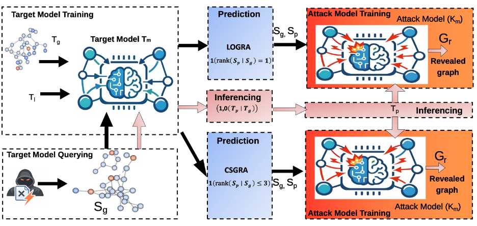

# The Graph Revealer: Generative Diffusion Model Inversion Attacks against Graph Neural Networks

The Figure below shows the framework of The Graph Revealer:
<h1 align="center">
  
</h1>


#### Keywords: Graph Reconstruction Attacks, Generative Diffusion Models,  Model Inversion Threats, Privacy Vulnerabilities, Label-only Attacks

# LOGRA — Graph Generation Benchmark

A benchmarking framework for revealing target model training data demonstrated using three architectures:
**Laplace Diffusion** (proposed), **GAN** (random), and **CVAE** (base).
Each architecture is evaluated against real graph data using a GIN-based shadow model attack pipeline.

---

## Table of Contents

- [Overview](#overview)
- [Pipeline](#pipeline)
- [Project Structure](#project-structure)
- [Requirements](#requirements)
- [Installation](#installation)
- [Configuration](#configuration)
- [Usage](#usage)
- [Output](#output)
- [Evaluation Metrics](#evaluation-metrics)
- [Citation](#citation)

---

## Overview
The Graph Revealer: Generative Diffusion Model Inversion Attacks against Graph Neural Networks ....


---

## Pipeline

```
Full Dataset
    ├── 50% → Target split
    │       ├── 80% → Train set   ──► trains GIN classifier
    │       └── 20% → Test set    ──► evaluates GIN classifier
    │
    └── 50% → Shadow split
              └── queried through trained GIN classifier
                      ├── Correct predictions  → training data for generative model
                      └── Incorrect predictions → discarded
                                  ↓
                      GAN / Diffusion / CVAE trained on correct shadow graphs
                                  ↓
              Target split queried for predicted labels
                                  ↓
                      Generated graphs evaluated against target graphs
```

---

## Project Structure

```
LOGRA/
│
├── main.py               # CLI entry-point and full pipeline
├── config.py             # Dataset configs, arch configs, hyperparameters
│
├── data/                 # Downloaded datasets (auto-created)
├── models/               # Saved model checkpoints (auto-created)
└── outputs/              # CSV results and summary files (auto-created)
```

---

## Requirements

- Python >= 3.8
- PyTorch >= 1.13
- PyTorch Geometric >= 2.0
- GraKeL
- NetworkX
- scikit-learn
- scipy
- tqdm
- pandas
- numpy
- matplotlib
All the required modules are placed in requirements.txt
### Supported Datasets

| Dataset   | Source       | Type                  |
|-----------|--------------|-----------------------|
| ENZYMES   | TUDataset    | Graph classification  |
| NCI1      | TUDataset    | Graph classification  |
| Cora      | Planetoid    | node classification   |
| PolBlogs  | PolBlogs     | node classification   |

---

## Installation

### 1. Clone the repository

```bash
git clone https://github.com/SayantonDibbo/Graph-Revealer.git
```

### 2. Create a virtual environment (recommended)

```bash
python -m venv venv
source venv/bin/activate        # Linux / macOS
venv\Scripts\activate           # Windows
```

### 3. Install PyTorch

Visit [https://pytorch.org/get-started/locally](https://pytorch.org/get-started/locally) and select the appropriate command for your system and CUDA version. For example:

```bash
# CPU only
pip install torch torchvision torchaudio

# CUDA 11.8
pip install torch torchvision torchaudio --index-url https://download.pytorch.org/whl/cu118
```

### 4. Install PyTorch Geometric

```bash
pip install torch-geometric

# Optional but recommended for full PyG support:
pip install torch-scatter torch-sparse torch-cluster torch-spline-conv \
    -f https://data.pyg.org/whl/torch-<YOUR_TORCH_VERSION>+<CUDA>.html
```

Replace `<YOUR_TORCH_VERSION>` (e.g. `2.0.0`) and `<CUDA>` (e.g. `cu118` or `cpu`) accordingly.

### 5. Install remaining dependencies

```bash
pip install grakel networkx scikit-learn scipy tqdm pandas numpy matplotlib
```

### 6. Verify installation

```bash
python -c "import torch; import torch_geometric; import grakel; print('All dependencies OK')"
```

---

## Configuration

All dataset and architecture settings are managed in `config.py`. Key sections:

### `DATASET_CONFIGS`
Defines per-dataset properties such as number of classes, max nodes, node feature dimension, and data source.

### `ARCH_CONFIGS`
Describes each generative architecture (`proposed`, `random`, `base`) with a short description.

### `GIN_CONFIG`
Controls the GIN classifier's hidden dimensions and batch size.

### `get_train_config(arch, dataset)`
Returns epoch counts for the classifier and generative model per (arch, dataset) combination.

### `get_gen_config(arch)`
Returns default hyperparameters for each generative model (learning rate, latent dim, hidden dim, etc.).

---

## Usage

All experiments are launched through `main.py` via the command line.

### Basic syntax

```bash
python main.py --arch <arch> --dataset <dataset> --attack <attack> [options]
```

### Arguments

| Argument | Required | Description |
|---|---|---|
| `--arch` | ✅ | Architecture: `proposed` / `random` / `base` |
| `--dataset` | ✅ | One or more dataset names (space-separated) |
| `--attack` | ✅ | Attack type: `logra` / `csgra` / `sota`  |
| `--seeds` | ❌ | Random seeds (default: `11 22 33 44 55`) |
| `--epochs-classifier` | ❌ | Override classifier training epochs |
| `--epochs-gen` | ❌ | Override generative model training epochs |
| `--gen-lr` | ❌ | Learning rate for the generative model |
| `--gen-batch-size` | ❌ | Batch size for generative model training |
| `--latent-dim` | ❌ | Latent dimension (GAN / CVAE) |
| `--hidden-dim` | ❌ | Hidden dimension for generator/encoder/decoder |
| `--beta-schedule` | ❌ | CVAE KL annealing: `constant` / `linear` / `cyclical` |
| `--lr-g` | ❌ | GAN generator learning rate |
| `--lr-d` | ❌ | GAN discriminator learning rate |
| `--data-root` | ❌ | Root folder for datasets (default: `./data`) |
| `--model-root` | ❌ | Root folder for checkpoints (default: `./models`) |
| `--output-root` | ❌ | Root folder for results (default: `./outputs`) |
| `--skip-classifier` | ❌ | Load classifier from disk instead of training |
| `--skip-gen` | ❌ | Load generative model from disk instead of training |
| `--dry-run` | ❌ | Print resolved config and exit without running |
| `--device` | ❌ | Force device: `cuda` / `cpu` / `mps` |

### Examples

```bash
# Proposed (Laplace Diffusion) on ENZYMES with seeds 11 and 22
python main.py --arch proposed --dataset ENZYMES --seeds 11 22

# GAN on NCI1 with custom epochs
python main.py --arch random --dataset NCI1 --epochs-classifier 300 --epochs-gen 70

# CVAE on Cora with all default seeds
python main.py --arch base --dataset Cora

# Multiple datasets in one run
python main.py --arch proposed --dataset Cora ENZYMES NCI1

# Override generative model learning rate and batch size
python main.py --arch proposed --dataset ENZYMES --gen-lr 5e-4 --gen-batch-size 16

# Skip classifier training (load saved checkpoint) and run generation only
python main.py --arch base --dataset ENZYMES --skip-classifier

# Dry-run: inspect resolved config without running
python main.py --arch proposed --dataset Cora --dry-run
```

---

## Output

After each run, the following files are saved to `--output-root` (default: `./outputs/`):

| File | Description |
|---|---|
| `{dataset}_{arch}_seed{seed}.csv` | Per-graph distance metrics (FGD, Euclidean, MMD, Kernel, Spectral) |
| `structural_{dataset}_{arch}_seed{seed}.csv` | Per-graph structural similarity scores (Degree, LCC, Betweenness, Closeness) |
| `{arch}_metrics_summary.txt` | Aggregated mean ± std across all seeds for all datasets |

Model checkpoints are saved to `--model-root`:

| File | Description |
|---|---|
| `best_model.pth` | Best GIN classifier checkpoint |
| `train_log.csv` | Epoch-by-epoch classifier training log |
| `gen_model.pth` | Saved generative model checkpoint |

---

## Evaluation Metrics

### Distance / Embedding Metrics

| Metric | Description |
|---|---|
| **FGD** | Fréchet Graph Distance — embedding-level distributional distance between real and generated graphs |
| **EGD** | L2 distance between GCN embeddings of paired real and generated graphs |
| **MMD** | Maximum Mean Discrepancy between graph embeddings using a Gaussian kernel |
| **GKS** | Weisfeiler-Lehman graph kernel similarity score |
| **SD** | L2 distance between normalised Laplacian eigenvalue spectra |

### Structural Similarity Metrics (Wasserstein-based, reported as %)

| Metric | Description |
|---|---|
| **Degree** | Similarity of degree distributions |
| **LCC** | Similarity of local clustering coefficient distributions |
| **Betweenness** | Similarity of betweenness centrality distributions |
| **Closeness** | Similarity of closeness centrality distributions |

Higher structural scores (closer to 100%) indicate better structural fidelity. Lower distance metrics indicate better generative quality.

---

## Citation

If you use this code in your research, please cite:

```bibtex
@misc{GraphRevealer2026,
  title  = {LOGRA: Graph Generation Benchmark under Shadow Model Settings},
  author = {Name},
  year   = {2026},
  url    = {}
}
```

---

## License

This project is licensed under the MIT License. See `LICENSE` for details.